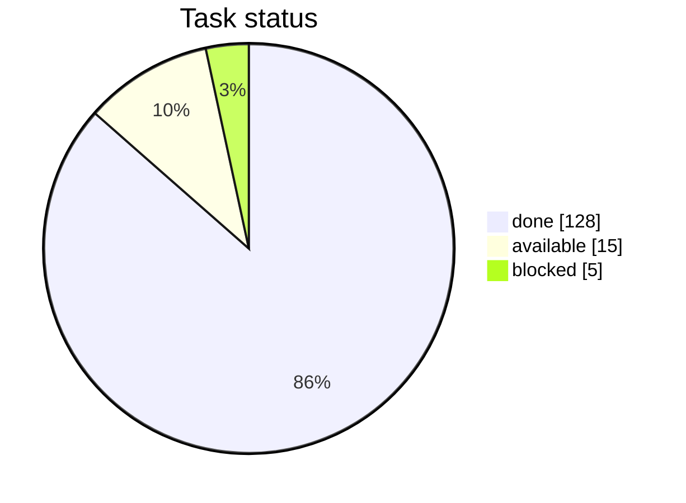
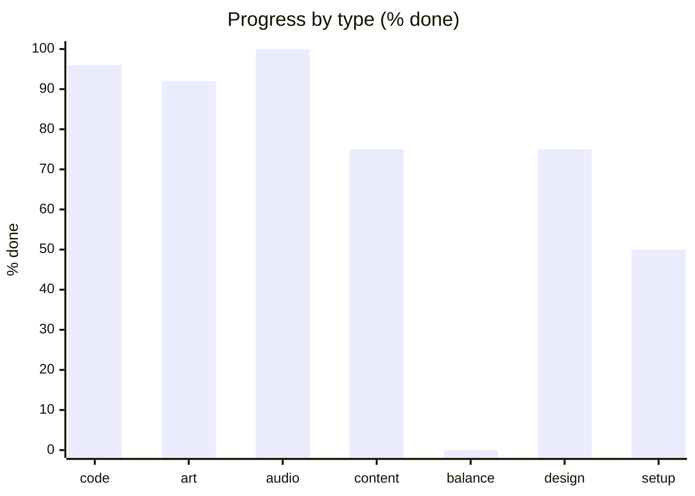
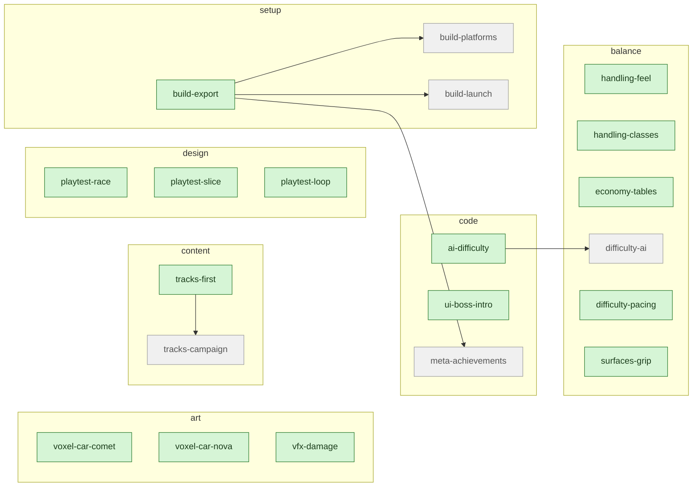

# RallyRivals — Task Status

> Generated by `python3 tasks.py render`. **Do not hand-edit** — edit `tasks.yaml`.

**Overall:** 128/148 done (86%) · 15 available · 5 blocked

## Progress by type

### By subgroup

| type | subgroup | done | total |
|---|---|--:|--:|
| code | core | 5 | 5 |
| code | vehicle | 7 | 7 |
| code | track | 9 | 9 |
| code | ai | 2 | 3 |
| code | race | 11 | 11 |
| code | meta | 8 | 9 |
| code | ui | 16 | 17 |
| code | tools | 8 | 8 |
| art | voxel | 21 | 23 |
| art | vfx | 4 | 5 |
| art | ui-art | 3 | 3 |
| art | world | 3 | 3 |
| art | shader | 3 | 3 |
| audio | sfx | 6 | 6 |
| audio | music | 4 | 4 |
| content | tracks | 0 | 2 |
| content | cars | 2 | 2 |
| content | rivals | 3 | 3 |
| content | surfaces | 1 | 1 |
| balance | handling | 0 | 2 |
| balance | economy | 0 | 1 |
| balance | difficulty | 0 | 2 |
| balance | surfaces | 0 | 1 |
| design | gdd | 3 | 3 |
| design | adr | 3 | 3 |
| design | spec | 2 | 2 |
| design | playtest | 1 | 4 |
| setup | config | 2 | 2 |
| setup | build | 0 | 3 |
| setup | repo | 1 | 1 |

## Available now (15 unblocked)

- `art-vfx-damage` [art/vfx] (default) — Voxel-chipping damage FX
- `art-voxel-car-comet` [art/voxel] (default) — Voxel car: Comet (Mayfly A)
- `art-voxel-car-nova` [art/voxel] (default) — Voxel car: Nova (Mayfly S)
- `balance-difficulty-pacing` [balance/difficulty] (default) — Chapter CP-gate % + progression pacing
- `balance-economy-tables` [balance/economy] (default) — Payout/price tables (banked-best economy)
- `balance-handling-feel` [balance/handling] (big) — Tune car feel constants (buttery pass)
- `balance-handling-classes` [balance/handling] (default) — Differentiate feel across classes/brands
- `balance-surfaces-grip` [balance/surfaces] (default) — Tune grip values per surface + weather modifiers
- `code-ai-difficulty` [code/ai] (default) — Difficulty via opponents + track complexity
- `code-ui-boss-intro` [code/ui] (default) — Boss-rival intro screen (car + class)
- `content-tracks-first` [content/tracks] (big) — First real track (heightmap/surface/markers images)
- `design-playtest-race` [design/playtest] (default) — Fun verdict: full race (tense + fair)
- `design-playtest-slice` [design/playtest] (default) — Fun verdict: vertical slice (one polished race)
- `design-playtest-loop` [design/playtest] (default) — Fun verdict: campaign loop (want-next-win)
- `setup-build-export` [setup/build] (default) — Export presets + exclude prototypes/* from release

## Blocked (5)

- `code-meta-achievements` — waiting on: setup-build-export
- `content-tracks-campaign` — waiting on: content-tracks-first
- `balance-difficulty-ai` — waiting on: code-ai-difficulty
- `setup-build-platforms` — waiting on: setup-build-export
- `setup-build-launch` — waiting on: setup-build-export

## Dependency graph (remaining work)

_Green = available now · gray = blocked. Done tasks omitted._

