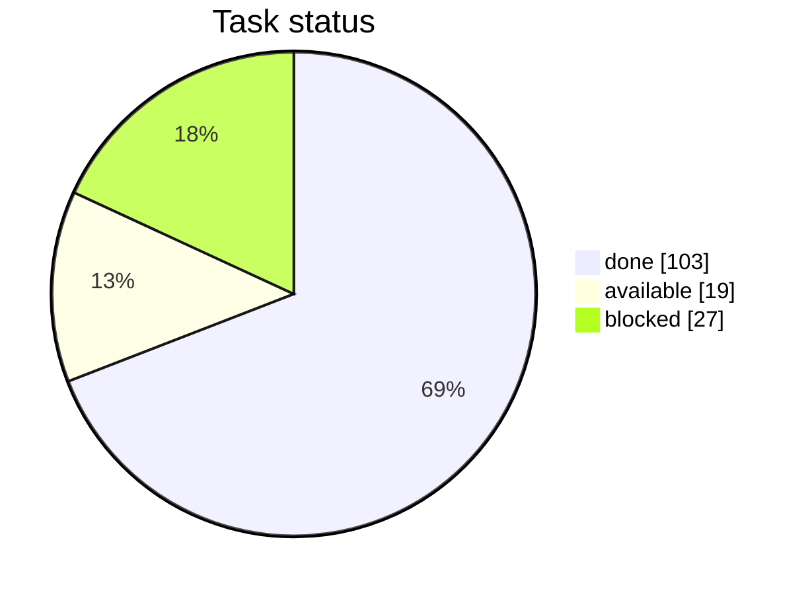
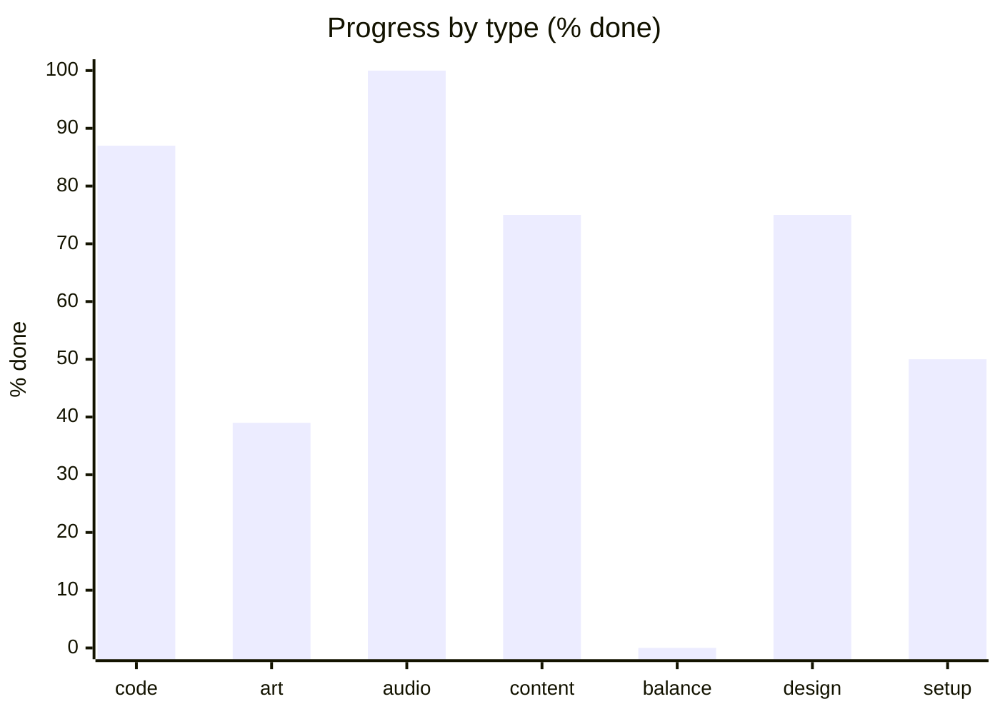

# RallyRivals — Task Status

> Generated by `python3 tasks.py render`. **Do not hand-edit** — edit `tasks.yaml`.

**Overall:** 103/149 done (69%) · 19 available · 27 blocked

## Progress by type

### By subgroup

| type | subgroup | done | total |
|---|---|--:|--:|
| code | core | 4 | 5 |
| code | vehicle | 7 | 7 |
| code | track | 7 | 9 |
| code | ai | 2 | 3 |
| code | race | 11 | 11 |
| code | meta | 6 | 9 |
| code | ui | 15 | 17 |
| code | tools | 8 | 8 |
| art | voxel | 2 | 23 |
| art | vfx | 4 | 5 |
| art | ui-art | 3 | 3 |
| art | world | 3 | 4 |
| art | shader | 3 | 3 |
| audio | sfx | 6 | 6 |
| audio | music | 4 | 4 |
| content | tracks | 0 | 2 |
| content | cars | 2 | 2 |
| content | rivals | 3 | 3 |
| content | surfaces | 1 | 1 |
| balance | handling | 0 | 2 |
| balance | economy | 0 | 1 |
| balance | difficulty | 0 | 2 |
| balance | surfaces | 0 | 1 |
| design | gdd | 3 | 3 |
| design | adr | 3 | 3 |
| design | spec | 2 | 2 |
| design | playtest | 1 | 4 |
| setup | config | 2 | 2 |
| setup | build | 0 | 3 |
| setup | repo | 1 | 1 |

## Available now (19 unblocked)

- `art-vfx-damage` [art/vfx] (default) — Voxel-chipping damage FX
- `art-voxel-props` [art/voxel] (big) — Voxel prop set (rocks/signs/barriers) — each prop authored per region x3 for scatter variety
- `art-voxel-environment` [art/voxel] (big) — Voxel scenery/buildings set
- `art-voxel-brand-families` [art/voxel] (default) — Visual family per manufacturer
- `art-voxel-car-kerb` [art/voxel] (default) — Voxel car: Kerb (Apex D, starter) — MV pipeline validation
- `balance-economy-tables` [balance/economy] (default) — Payout/price tables (banked-best economy)
- `balance-handling-feel` [balance/handling] (big) — Tune car feel constants (buttery pass)
- `balance-handling-classes` [balance/handling] (default) — Differentiate feel across classes/brands
- `balance-surfaces-grip` [balance/surfaces] (default) — Tune grip values per surface + weather modifiers
- `code-ai-difficulty` [code/ai] (default) — Difficulty via opponents + track complexity
- `code-core-pooling` [code/core] (default) — Pooling / perf helpers (perf-first rule)
- `code-meta-pinkslip` [code/meta] (default) — Beat rival -> win their car (pink-slip)
- `code-meta-chapters` [code/meta] (big) — Chapter CP gate (~70%) + advance on boss win
- `code-track-regions` [code/track] (default) — Apply region per race: off-road surface + prop set + dressing (RaceDef.region, replaces .season)
- `code-track-props` [code/track] (default) — Prop scatter from marker map
- `code-ui-boss-intro` [code/ui] (default) — Boss-rival intro screen (car + class)
- `content-tracks-first` [content/tracks] (big) — First real track (heightmap/surface/markers images)
- `design-playtest-race` [design/playtest] (default) — Fun verdict: full race (tense + fair)
- `setup-build-export` [setup/build] (default) — Export presets + exclude prototypes/* from release

## Blocked (27)

- `code-ui-career-map` — waiting on: code-meta-chapters
- `code-meta-achievements` — waiting on: setup-build-export
- `content-tracks-campaign` — waiting on: content-tracks-first
- `art-voxel-car-mule` — waiting on: art-voxel-brand-families, art-voxel-car-kerb
- `art-voxel-car-spark` — waiting on: art-voxel-brand-families, art-voxel-car-kerb
- `art-voxel-car-tangent` — waiting on: art-voxel-brand-families, art-voxel-car-kerb
- `art-voxel-car-crowbar` — waiting on: art-voxel-brand-families, art-voxel-car-kerb
- `art-voxel-car-fuse` — waiting on: art-voxel-brand-families, art-voxel-car-kerb
- `art-voxel-car-meridian` — waiting on: art-voxel-brand-families, art-voxel-car-kerb
- `art-voxel-car-anvil` — waiting on: art-voxel-brand-families, art-voxel-car-kerb
- `art-voxel-car-strobe` — waiting on: art-voxel-brand-families, art-voxel-car-kerb
- `art-voxel-car-verdict` — waiting on: art-voxel-brand-families, art-voxel-car-kerb
- `art-voxel-car-sledge` — waiting on: art-voxel-brand-families, art-voxel-car-kerb
- `art-voxel-car-comet` — waiting on: art-voxel-brand-families, art-voxel-car-kerb
- `art-voxel-car-stiletto` — waiting on: art-voxel-brand-families, art-voxel-car-kerb
- `art-voxel-car-juggernaut` — waiting on: art-voxel-brand-families, art-voxel-car-kerb
- `art-voxel-car-nova` — waiting on: art-voxel-brand-families, art-voxel-car-kerb
- `art-voxel-wheel-apex` — waiting on: art-voxel-brand-families
- `art-voxel-wheel-wreck` — waiting on: art-voxel-brand-families
- `art-voxel-wheel-mayfly` — waiting on: art-voxel-brand-families
- `art-world-regions` — waiting on: art-voxel-environment, art-voxel-props
- `balance-difficulty-ai` — waiting on: code-ai-difficulty
- `balance-difficulty-pacing` — waiting on: code-meta-chapters
- `design-playtest-slice` — waiting on: art-voxel-car-kerb
- `design-playtest-loop` — waiting on: code-meta-chapters, code-ui-career-map
- `setup-build-platforms` — waiting on: setup-build-export
- `setup-build-launch` — waiting on: setup-build-export

## Dependency graph (remaining work)

_Green = available now · gray = blocked. Done tasks omitted._

```mermaid
flowchart LR
  subgraph code
    code_track_regions["track-regions"]
    code_track_props["track-props"]
    code_core_pooling["core-pooling"]
    code_ai_difficulty["ai-difficulty"]
    code_ui_career_map["ui-career-map"]
    code_ui_boss_intro["ui-boss-intro"]
    code_meta_pinkslip["meta-pinkslip"]
    code_meta_achievements["meta-achievements"]
    code_meta_chapters["meta-chapters"]
  end
  subgraph art
    art_voxel_props["voxel-props"]
    art_voxel_environment["voxel-environment"]
    art_voxel_brand_families["voxel-brand-families"]
    art_voxel_car_kerb["voxel-car-kerb"]
    art_voxel_car_mule["voxel-car-mule"]
    art_voxel_car_spark["voxel-car-spark"]
    art_voxel_car_tangent["voxel-car-tangent"]
    art_voxel_car_crowbar["voxel-car-crowbar"]
    art_voxel_car_fuse["voxel-car-fuse"]
    art_voxel_car_meridian["voxel-car-meridian"]
    art_voxel_car_anvil["voxel-car-anvil"]
    art_voxel_car_strobe["voxel-car-strobe"]
    art_voxel_car_verdict["voxel-car-verdict"]
    art_voxel_car_sledge["voxel-car-sledge"]
    art_voxel_car_comet["voxel-car-comet"]
    art_voxel_car_stiletto["voxel-car-stiletto"]
    art_voxel_car_juggernaut["voxel-car-juggernaut"]
    art_voxel_car_nova["voxel-car-nova"]
    art_voxel_wheel_apex["voxel-wheel-apex"]
    art_voxel_wheel_wreck["voxel-wheel-wreck"]
    art_voxel_wheel_mayfly["voxel-wheel-mayfly"]
    art_vfx_damage["vfx-damage"]
    art_world_regions["world-regions"]
  end
  subgraph content
    content_tracks_first["tracks-first"]
    content_tracks_campaign["tracks-campaign"]
  end
  subgraph balance
    balance_handling_feel["handling-feel"]
    balance_handling_classes["handling-classes"]
    balance_economy_tables["economy-tables"]
    balance_difficulty_ai["difficulty-ai"]
    balance_difficulty_pacing["difficulty-pacing"]
    balance_surfaces_grip["surfaces-grip"]
  end
  subgraph design
    design_playtest_race["playtest-race"]
    design_playtest_slice["playtest-slice"]
    design_playtest_loop["playtest-loop"]
  end
  subgraph setup
    setup_build_export["build-export"]
    setup_build_platforms["build-platforms"]
    setup_build_launch["build-launch"]
  end
  code_meta_chapters --> code_ui_career_map
  setup_build_export --> code_meta_achievements
  content_tracks_first --> content_tracks_campaign
  art_voxel_brand_families --> art_voxel_car_mule
  art_voxel_car_kerb --> art_voxel_car_mule
  art_voxel_brand_families --> art_voxel_car_spark
  art_voxel_car_kerb --> art_voxel_car_spark
  art_voxel_brand_families --> art_voxel_car_tangent
  art_voxel_car_kerb --> art_voxel_car_tangent
  art_voxel_brand_families --> art_voxel_car_crowbar
  art_voxel_car_kerb --> art_voxel_car_crowbar
  art_voxel_brand_families --> art_voxel_car_fuse
  art_voxel_car_kerb --> art_voxel_car_fuse
  art_voxel_brand_families --> art_voxel_car_meridian
  art_voxel_car_kerb --> art_voxel_car_meridian
  art_voxel_brand_families --> art_voxel_car_anvil
  art_voxel_car_kerb --> art_voxel_car_anvil
  art_voxel_brand_families --> art_voxel_car_strobe
  art_voxel_car_kerb --> art_voxel_car_strobe
  art_voxel_brand_families --> art_voxel_car_verdict
  art_voxel_car_kerb --> art_voxel_car_verdict
  art_voxel_brand_families --> art_voxel_car_sledge
  art_voxel_car_kerb --> art_voxel_car_sledge
  art_voxel_brand_families --> art_voxel_car_comet
  art_voxel_car_kerb --> art_voxel_car_comet
  art_voxel_brand_families --> art_voxel_car_stiletto
  art_voxel_car_kerb --> art_voxel_car_stiletto
  art_voxel_brand_families --> art_voxel_car_juggernaut
  art_voxel_car_kerb --> art_voxel_car_juggernaut
  art_voxel_brand_families --> art_voxel_car_nova
  art_voxel_car_kerb --> art_voxel_car_nova
  art_voxel_brand_families --> art_voxel_wheel_apex
  art_voxel_brand_families --> art_voxel_wheel_wreck
  art_voxel_brand_families --> art_voxel_wheel_mayfly
  art_voxel_environment --> art_world_regions
  art_voxel_props --> art_world_regions
  code_ai_difficulty --> balance_difficulty_ai
  code_meta_chapters --> balance_difficulty_pacing
  art_voxel_car_kerb --> design_playtest_slice
  code_meta_chapters --> design_playtest_loop
  code_ui_career_map --> design_playtest_loop
  setup_build_export --> setup_build_platforms
  setup_build_export --> setup_build_launch
  classDef avail fill:#d6f5d6,stroke:#2e7d32,color:#1b3d1b;
  classDef blocked fill:#f0f0f0,stroke:#9e9e9e,color:#555;
  class code_track_regions,code_track_props,code_core_pooling,code_ai_difficulty,code_ui_boss_intro,code_meta_pinkslip,code_meta_chapters,content_tracks_first,art_voxel_props,art_voxel_environment,art_voxel_brand_families,art_voxel_car_kerb,art_vfx_damage,balance_handling_feel,balance_handling_classes,balance_economy_tables,balance_surfaces_grip,design_playtest_race,setup_build_export avail;
  class code_ui_career_map,code_meta_achievements,content_tracks_campaign,art_voxel_car_mule,art_voxel_car_spark,art_voxel_car_tangent,art_voxel_car_crowbar,art_voxel_car_fuse,art_voxel_car_meridian,art_voxel_car_anvil,art_voxel_car_strobe,art_voxel_car_verdict,art_voxel_car_sledge,art_voxel_car_comet,art_voxel_car_stiletto,art_voxel_car_juggernaut,art_voxel_car_nova,art_voxel_wheel_apex,art_voxel_wheel_wreck,art_voxel_wheel_mayfly,art_world_regions,balance_difficulty_ai,balance_difficulty_pacing,design_playtest_slice,design_playtest_loop,setup_build_platforms,setup_build_launch blocked;
```

